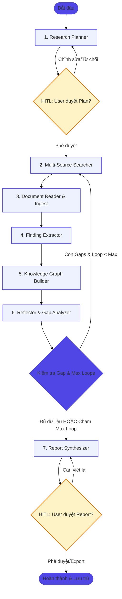

---

### 1. KIẾN TRÚC TỔNG THỂ & MERMAID DIAGRAM



---

### 2. ĐỊNH NGHĨA STATE SCHEMA (PYTHON TYPEDDICT / PYDANTIC)

State trong LangGraph cần lưu trữ toàn bộ tiến trình nghiên cứu, dữ liệu tích lũy và kiểm soát vòng lặp. Ta dùng cơ chế `Annotated` với reducer (như `operator.add`) để append dữ liệu mới mà không ghi đè dữ liệu cũ.

```python
from typing import Annotated, List, Dict, Any, Optional
from typing_extensions import TypedDict
from pydantic import BaseModel, Field
import operator

# --- Sub-schemas ---
class ResearchSubQuestion(BaseModel):
    id: str
    question: str
    target_source: str  # "academic", "web", "pdf"
    status: str = "pending"  # "pending", "completed", "failed"

class SourceMetadata(BaseModel):
    source_id: str  # e.g., "REF_1", "REF_2"
    url: Optional[str] = None
    title: str
    authors: List[str] = []
    year: Optional[int] = None
    source_type: str  # "paper", "webpage", "uploaded_pdf"
    content_clean: Optional[str] = None  # Markdown text

class ExtractedFinding(BaseModel):
    claim: str
    evidence: str
    source_ids: List[str]  # Map ngược lại SourceMetadata.source_id
    confidence_score: float

class KnowledgeGap(BaseModel):
    missing_aspect: str
    suggested_query: str
    target_source: str

# --- Main LangGraph State ---
class DeepResearchState(TypedDict):
    # User Input & Session Info
    research_question: str
    session_id: str
    user_uploaded_files: List[str]  # File paths to local PDFs
    
    # HITL Control Flags
    plan_approved: bool
    report_approved: bool
    user_feedback: Optional[str]

    # Planning Phase
    research_plan: List[ResearchSubQuestion]
    
    # Loop Counter & Limits
    loop_count: int
    max_loops: int
    
    # Knowledge Accumulation (Appendable lists)
    sources_found: Annotated[List[SourceMetadata], operator.add]
    documents_read: Annotated[List[Dict[str, Any]], operator.add]
    extracted_findings: Annotated[List[ExtractedFinding], operator.add]
    
    # Reflection Phase
    knowledge_gaps: List[KnowledgeGap]
    reflection_summary: str
    
    # Output Phase
    report_draft: Optional[str]
    final_report: Optional[str]
    
    # Error & Audit Logging
    errors: Annotated[List[str], operator.add]
```

---

### 3. CHI TIẾT 7 NODES CỐT LÕI

#### Node 1: `planner` (Lập kế hoạch nghiên cứu)
* **Nhiệm vụ:** Phân rã `research_question` thành 3–5 câu hỏi phụ (`ResearchSubQuestion`) và chiến lược tìm kiếm (tìm trên arXiv hay Google Web).
* **Prompt Logic:** Yêu cầu LLM tạo cấu trúc JSON có phân bổ nguồn rõ ràng: câu hỏi nền tảng học thuật $\rightarrow$ Semantic Scholar, so sánh benchmark mới nhất $\rightarrow$ Tavily web.
* **Output:** Cập nhật `research_plan`, đặt `loop_count = 0`, `plan_approved = False`.

#### Node 2: `searcher` (Bộ tìm kiếm đa nguồn)
* **Nhiệm vụ:** Đọc các sub-questions đang ở trạng thái `pending` hoặc các `knowledge_gaps` từ vòng trước để thực thi Tool Calling:
  * Gọi `search_papers()` (Semantic Scholar API): Lấy `title`, `abstract`, `authors`, `doi`, `citationCount`.
  * Gọi `search_web()` (Tavily API): Tìm kiếm các bài viết, blog, documentation.
* **Xử lý:** Lọc trùng lặp URL/Title với các `sources_found` đã có ở các vòng trước.
* **Output:** Cập nhật `sources_found` (cấp phát ID duy nhất: `REF_1`, `REF_2`...).

#### Node 3: `reader` (Đọc & Ingest tài liệu)
* **Nhiệm vụ:** 
  * Cào nội dung sạch từ Web bằng **Jina Reader** (`r.jina.ai/<URL>`).
  * Đọc file PDF upload (nếu có) bằng **PyMuPDF4LLM**.
  * Cắt nhỏ (Semantic Chunking) $\rightarrow$ Sinh Vector Embeddings $\rightarrow$ Nạp thẳng vào collection tạm trên **Qdrant** phục vụ tra cứu ngữ nghĩa.
* **Output:** Cập nhật `documents_read`.

#### Node 4: `extractor` (Trích xuất tri thức)
* **Nhiệm vụ:** Không nhồi nhét toàn bộ tài liệu thô cho LLM. Node này truy vấn Qdrant để lấy các context liên quan nhất đến từng câu hỏi phụ $\rightarrow$ yêu cầu LLM trích xuất:
  * Các luận điểm cốt lõi (Claims/Findings).
  * Thực thể (Entities: Tên thuật toán, Công nghệ, Tác giả).
  * Bắt buộc gắn thẻ nguồn `source_ids = ["REF_1"]`.
* **Output:** Cập nhật `extracted_findings`.

#### Node 5: `knowledge_graph_builder` (Xây dựng đồ thị tri thức)
* **Nhiệm vụ:** Lấy các findings và metadata từ Node 4 $\rightarrow$ chuyển đổi thành truy vấn Cypher chạy trực tiếp vào Neo4j:
  * Tạo nodes: `(:Paper)`, `(:Author)`, `(:Concept)`, `(:Finding)`.
  * Tạo quan hệ: `(:Paper)-[:PROPOSES]->(:Concept)`, `(:Paper)-[:CITES]->(:Paper)`.
* **Output:** Ghi dữ liệu vào Neo4j (không cần thay đổi state, chỉ log số lượng triplets đã tạo).

#### Node 6: `reflector` (Phản tư & Đánh giá lỗ hổng)
* **Nhiệm vụ:** LLM đối chiếu toàn bộ `extracted_findings` với `research_plan` ban đầu để trả lời 3 câu hỏi:
  1. Các câu hỏi nghiên cứu đã có bằng chứng xác thực chưa?
  2. Có luận điểm nào mâu thuẫn giữa các nguồn cần kiểm chứng thêm không?
  3. Còn thiếu thông tin thực nghiệm/số liệu nào?
* **Output:** Trả về danh sách `knowledge_gaps` và tăng `loop_count += 1`.

#### Node 7: `synthesizer` (Tổng hợp báo cáo)
* **Nhiệm vụ:** Khi thông tin đã đủ (hoặc hết budget vòng lặp), LLM viết báo cáo học thuật đầy đủ:
  * Khung báo cáo: Executive Summary $\rightarrow$ Background $\rightarrow$ Methodology/Analysis $\rightarrow$ Discussion & Gaps $\rightarrow$ References.
  * Ép định dạng Markdown với trích dẫn chuẩn: `Theo nhóm nghiên cứu DeepSeek [^REF_3], chi phí train...`
  * Tạo danh mục tài liệu tham khảo ở cuối bài ánh xạ chính xác từ `sources_found`.
* **Output:** Cập nhật `report_draft`.

---

### 4. ĐỊNH TUYẾN CONDITIONAL EDGE (TRÁNH INFINITE LOOP)

Hàm điều kiện `should_continue` quyết định luồng rẽ sau Node `reflector`:

```python
from langgraph.graph import END

def should_continue(state: DeepResearchState) -> str:
    """
    Điều kiện dừng:
    1. Đã hết kiến thức bị thiếu (knowledge_gaps rỗng) -> Sang Synthesizer.
    2. HOẶC loop_count chạm ngưỡng max_loops -> Ép sang Synthesizer (Circuit Breaker).
    3. Ngược lại -> Tiếp tục quay lại Searcher để lấp lỗ hổng.
    """
    gaps = state.get("knowledge_gaps", [])
    current_loop = state.get("loop_count", 0)
    max_loops = state.get("max_loops", 3)
    
    # Circuit Breaker: Đạt ngưỡng tối đa
    if current_loop >= max_loops:
        return "synthesizer"
    
    # Nếu không còn lỗ hổng kiến thức nghiêm trọng
    if not gaps or len(gaps) == 0:
        return "synthesizer"
    
    # Vẫn còn lỗ hổng và còn ngân sách vòng lặp
    return "searcher"
```

---

### 5. CƠ CHẾ HUMAN-IN-THE-LOOP (HITL)

Sử dụng tính năng **`interrupt`** của LangGraph (v0.2+) kết hợp với checkpointer (PostgresSaver / MemorySaver) để tạm dừng pipeline, trả quyền kiểm soát về Frontend:

```python
from langgraph.types import interrupt, Command

# --- HITL TẠI BƯỚC 1: DUYỆT KẾ HOẠCH NGHIÊN CỨU ---
def planner_node(state: DeepResearchState):
    # LLM tạo kế hoạch...
    generated_plan = [ ... ]
    
    # Tạm dừng execution và đẩy state về phía React UI
    user_action = interrupt({
        "type": "PLAN_APPROVAL_REQUIRED",
        "plan": generated_plan,
        "message": "Vui lòng xem xét, xóa bớt hoặc thêm các hướng nghiên cứu."
    })
    
    # Khi user tương tác trên UI và bấm "Tiếp tục" qua API /resume
    if user_action.get("action") == "modify":
        return {"research_plan": user_action.get("modified_plan"), "plan_approved": True}
    
    return {"research_plan": generated_plan, "plan_approved": True}

# --- HITL TẠI BƯỚC 2: DUYỆT BÁO CÁO CUỐI ---
def synthesizer_node(state: DeepResearchState):
    # LLM sinh bản nháp báo cáo...
    draft = "..."
    
    user_action = interrupt({
        "type": "REPORT_APPROVAL_REQUIRED",
        "report_draft": draft,
        "message": "Báo cáo nghiên cứu đã sẵn sàng. Bạn có muốn chỉnh sửa phần nào không?"
    })
    
    if user_action.get("action") == "feedback":
        # User yêu cầu sửa -> Lưu feedback và cho viết lại
        return {"report_draft": draft, "user_feedback": user_action.get("comment")}
        
    return {"final_report": user_action.get("final_content", draft), "report_approved": True}
```

* **Phía Frontend (React):** 
  * Khi nhận event `PLAN_APPROVAL_REQUIRED`, React hiển thị bảng Kanban/Checklist cho phép user tick chọn/sửa/xóa sub-questions.
  * Bấm **"Approve & Research"** $\rightarrow$ gọi endpoint `POST /api/research/{session_id}/resume` kèm payload.

---

### 6. CHIẾN LƯỢC XỬ LÝ KHI SOURCE TRẢ VỀ LỖI / RỖNG (RESILIENCE & FALLBACKS)

Không để agent bị "chết đứng" (Unhandled Exception) khi các API bên ngoài gặp sự cố:

```
                      ┌────────────────────────────┐
                      │    Gọi Search / Scrape     │
                      └──────────────┬─────────────┘
                                     │
           ┌─────────────────────────┼─────────────────────────┐
           ▼                         ▼                         ▼
   [HTTP Error / 403/404]     [Rate Limit 429]        [Empty Results 0 bài]
           │                         │                         │
           ▼                         ▼                         ▼
Đánh dấu source status:      Kích hoạt Tenacity        Fallback sang Searcher khác:
"failed_to_scrape".          Exponential Backoff       Nếu Semantic Scholar rỗng 
Bỏ qua, ghi log errors.      (Retry 3 lần: 2s, 4s, 8s) -> chuyển Tavily Web query
TIẾP TỤC ĐỌC NGUỒN KHÁC.     Nếu vẫn lỗi -> Chuyển     dưới dạng: "site:arxiv.org..."
                             fallback search provider.
```

1. **Khi cào Web bằng Jina Reader bị lỗi (403/Timeout):**
   * Bọc `try/except httpx.HTTPError`. Nếu thất bại, tự động fallback sang đọc snippet tóm tắt có sẵn trong kết quả của Tavily Search thay vì bỏ rơi dữ liệu.
2. **Khi Semantic Scholar không có kết quả:**
   * Tự động điều chỉnh query: Bỏ bớt từ khóa quá dài (Relax query), chuyển từ khóa học thuật sang tiếng Anh nếu user nhập tiếng Việt.
   * Nếu vẫn không có: Gọi Tavily với cú pháp nâng cao: `site:arxiv.org OR site:semanticscholar.org <query>`.
3. **Khi toàn bộ các nguồn trong 1 vòng lặp đều thất bại:**
   * Agent không tự crash. Node `reflector` nhận diện: *"Vòng tìm kiếm này thu được 0 thông tin mới"*.
   * LLM sẽ tự ghi nhận vào `knowledge_gaps`: *"Không thể tiếp cận tài liệu về [X] do thiếu nguồn công khai"*, sau đó chuyển sang Node `synthesizer` để xuất báo cáo kèm **cảnh báo hạn chế dữ liệu (Limitation Warning)** cho người dùng.