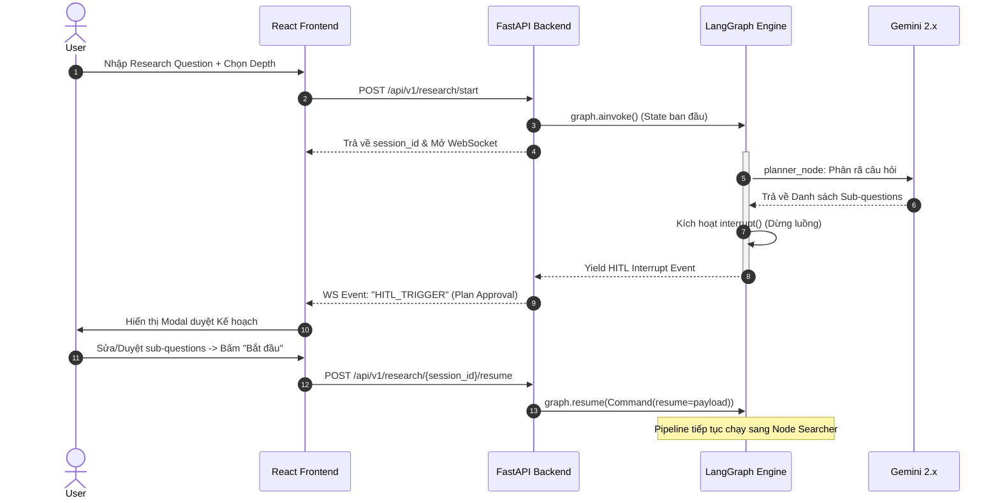
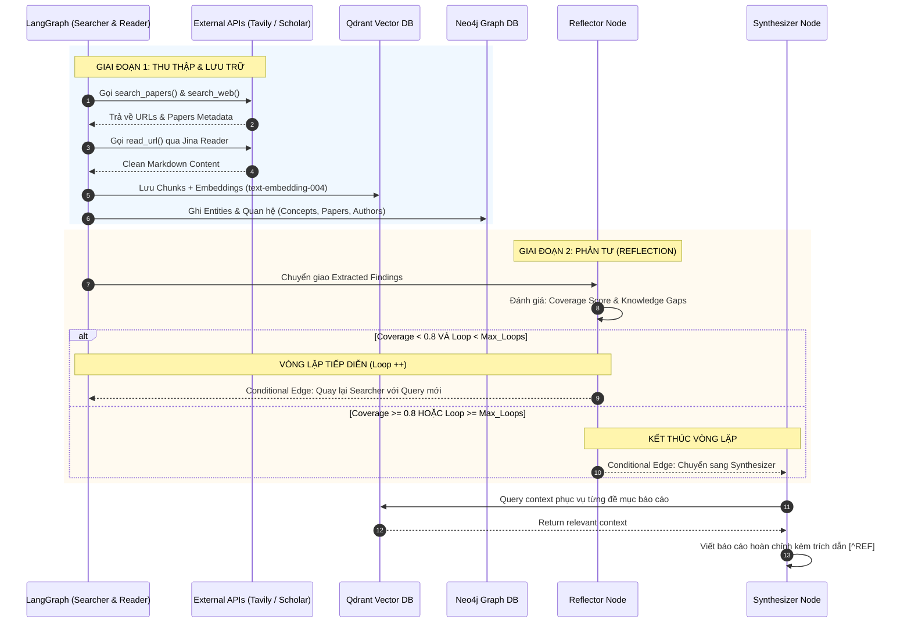

---

### MẢNH GHÉP 1: TÀI LIỆU SYSTEM PROMPTS CHO TỪNG NODE

Mỗi node trong LangGraph đảm nhận một vai trò nhận thức (cognitive role) riêng biệt. Cần tách biệt rõ System Prompt của từng node:

#### 1. Planner Prompt (`planner_node`)
```text
[ROLE]
Bạn là Trưởng nhóm Nghiên cứu Học thuật (Lead Research Strategist).
Nhiệm vụ của bạn là phân tích câu hỏi nghiên cứu của người dùng và lập kế hoạch thu thập thông tin đa tầng.

[RULES]
1. Phân rã câu hỏi lớn thành 3-5 câu hỏi phụ (sub-questions) độc lập nhưng bổ trợ cho nhau.
2. Với mỗi câu hỏi, chỉ định rõ nguồn dữ liệu tối ưu:
   - "academic": Nếu cần định nghĩa, thuật toán, công thức toán, hoặc so sánh khoa học (sẽ tìm trên Semantic Scholar).
   - "web": Nếu cần thông tin thực tế, cập nhật thị trường, tài liệu hãng, case study 2024-2025 (sẽ tìm qua Tavily).
3. Đặt mục tiêu tìm kiếm (search queries) bằng tiếng Anh chuẩn học thuật, dù câu hỏi gốc là tiếng Việt.
4. Trả về đúng định dạng JSON được quy định. Không thêm lời chào hỏi.
```

#### 2. Reflector Prompt (`reflector_node`)
```text
[ROLE]
Bạn là Chuyên gia Thẩm định Nghiên cứu (Peer Reviewer & Critical Thinker).
Nhiệm vụ của bạn là đọc các phát hiện hiện có, đối chiếu với Kế hoạch ban đầu và tìm ra các "Lỗ hổng Tri thức" (Knowledge Gaps).

[RULES]
1. Đánh giá khách quan: Các câu hỏi nghiên cứu đã có số liệu hoặc luận điểm chứng minh rõ ràng chưa?
2. Phát hiện mâu thuẫn: Có bài viết nào đưa ra kết luận trái ngược với bài khác không?
3. Tính toán "Coverage Score" (0.0 - 1.0):
   - Nếu Coverage Score >= 0.8: Đặt "has_enough_info" = True, không tạo thêm sub-questions mới.
   - Nếu Coverage Score < 0.8: Chỉ ra chính xác khía cạnh nào còn thiếu và sinh ra tối đa 2 search queries bổ sung.
4. CẢNH BÁO: Không được tự bịa ra thông tin để lấp lỗ hổng. Nếu tài liệu không nói, phải coi là "chưa có dữ liệu".
```

#### 3. Synthesizer Prompt (`synthesizer_node`)
```text
[ROLE]
Bạn là Tác giả Tổng hợp Báo cáo Khoa học (Lead Scientific Writer).
Nhiệm vụ của bạn là viết một báo cáo chuyên sâu, mạch lạc dựa DUY NHẤT trên các thông tin đã được trích xuất.

[CONSTRAINTS & GROUNDING]
1. NGUYÊN TẮC BẤT DI BẤT DỊCH: Mọi khẳng định (claim) đều PHẢI có trích dẫn inline trỏ về mã nguồn, định dạng [^REF_X].
2. Nếu hai tài liệu có kết luận trái ngược nhau, hãy trình bày cả hai góc nhìn dưới dạng thảo luận phản biện (Critique).
3. Tuyệt đối không sử dụng tri thức ngoài context được cung cấp. Nếu thiếu thông tin, hãy viết: "Hiện chưa có đủ công trình công bố về khía cạnh này".

[OUTPUT FORMAT]
Báo cáo viết bằng Markdown chuẩn:
# [Tiêu đề Báo cáo]
## 1. Tóm tắt Điều hành (Executive Summary)
## 2. Bối cảnh & Cơ sở Lý thuyết
## 3. Phân tích Chuyên sâu & Ma trận So sánh
## 4. Những hạn chế & Thảo luận mở (Limitations & Discussion)
## 5. Danh mục Tài liệu Tham khảo (Bắt buộc ánh xạ đúng [^REF_X] -> URL/Tác giả)
```

---

### MẢNH GHÉP 2: API SCHEMA (REACT ↔ FASTAPI)

Kiến trúc kết hợp giữa **REST Endpoints** (cho các tác vụ Request/Response thông thường) và **WebSocket Events** (cho tiến trình Streaming real-time và tương tác HITL).

#### 1. REST Endpoints Schema

| Method | Endpoint | Mô tả | Request Body | Response Body |
|:---|:---|:---|:---|:---|
| `POST` | `/api/v1/research/start` | Khởi tạo phiên nghiên cứu | `{"question": str, "depth": "quick"\|"standard"\|"deep", "urls": []}` | `{"session_id": str, "status": "started"}` |
| `POST` | `/api/v1/research/upload-pdf` | Tải file PDF đính kèm | `multipart/form-data (file, session_id)` | `{"file_id": str, "pages": int, "status": "uploaded"}` |
| `POST` | `/api/v1/research/{session_id}/resume` | Gửi quyết định HITL của User | `{"action": "approve"\|"modify", "payload": dict}` | `{"status": "resumed"}` |
| `GET` | `/api/v1/research/{session_id}/graph` | Lấy dữ liệu Neo4j để vẽ UI | Không | `{"nodes": [{id, label, properties}], "links": [{source, target, type}]}` |
| `GET` | `/api/v1/research/{session_id}/export` | Xuất file báo cáo | Query params: `format=pdf\|docx\|md` | File Binary download |

#### 2. WebSocket Event Protocol (`ws://localhost:8000/ws/research/{session_id}`)

Toàn bộ gói tin trao đổi qua WebSocket tuân theo cấu trúc JSON chuẩn:
```typescript
interface WSMessage {
  event: "STEP_UPDATE" | "LOG_STREAM" | "HITL_TRIGGER" | "REPORT_CHUNK" | "DONE" | "ERROR";
  timestamp: string;
  data: any;
}
```

* **Server $\rightarrow$ Client: Báo trạng thái Node (`STEP_UPDATE`)**
  ```json
  {
    "event": "STEP_UPDATE",
    "data": { "current_step": "searcher", "loop_count": 1, "progress_percent": 30 }
  }
  ```
* **Server $\rightarrow$ Client: Kích hoạt modal HITL (`HITL_TRIGGER`)**
  ```json
  {
    "event": "HITL_TRIGGER",
    "data": {
      "type": "APPROVE_PLAN",
      "plan": [
        {"id": "sq_1", "question": "LangGraph state machine architecture", "source": "academic"},
        {"id": "sq_2", "question": "LangGraph latency benchmarks", "source": "web"}
      ]
    }
  }
  ```
* **Client $\rightarrow$ Server: Phản hồi HITL qua WebSocket (hoặc REST Resume)**
  ```json
  {
    "event": "HITL_RESPONSE",
    "data": { "action": "approve" }
  }
  ```
* **Server $\rightarrow$ Client: Streaming nội dung bài viết (`REPORT_CHUNK`)**
  ```json
  {
    "event": "REPORT_CHUNK",
    "data": { "chunk": "Theo công bố của nhóm tác giả LangChain [^REF_1]..." }
  }
  ```

---

### MẢNH GHÉP 3: SEQUENCE DIAGRAMS (CHO THIẾT KẾ & BẢO VỆ)

Hai sơ đồ tuần tự quan trọng nhất mô tả sự phối hợp giữa User, React, FastAPI, LangGraph và Neo4j/Qdrant.

#### Sơ đồ 1: Luồng Khởi tạo Nghiên cứu & Chốt Kế hoạch (HITL 1)



---

#### Sơ đồ 2: Vòng lặp Search - Ingest - Reflect (Self-Correction Loop)



---

### TỔNG KẾT
Với việc bổ sung **3 tài liệu này**:
1. Bạn đã có **System Prompts** để copy/paste ngay vào mã nguồn Python mà không cần nghĩ lại câu chữ.
2. Bạn đã có **API Contract chuẩn chỉ** để tách nhóm: một bạn làm Backend FastAPI, một bạn làm Frontend React độc lập mà không bị giẫm chân lên nhau.
3. Bạn đã có **Sequence Diagrams chuẩn UML** để đưa vào quyển Báo cáo Đồ án tốt nghiệp và trình chiếu thuyết phục trước hội đồng chuyên môn.