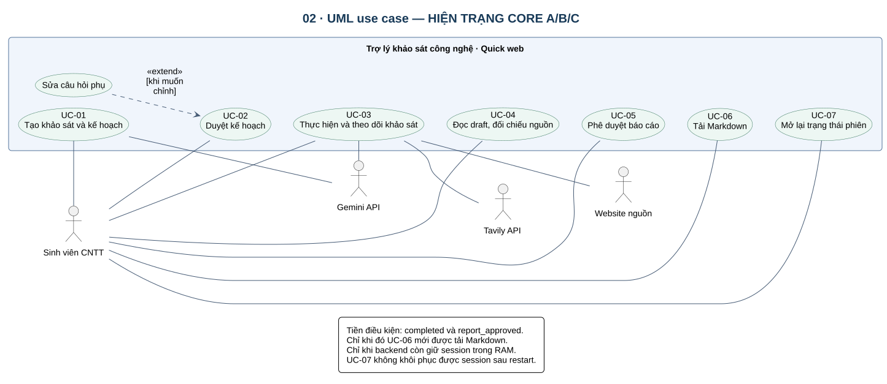
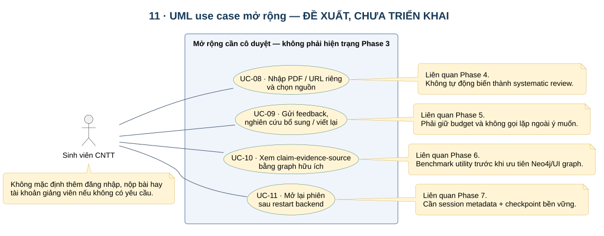

# 03 · Actors và đặc tả use case

## Ranh giới hệ thống

Đối tượng thiết kế là **ứng dụng hỗ trợ khảo sát**, gồm UI, backend, workflow và các kho dữ liệu do nhóm vận hành. Provider AI/tìm kiếm và website nguồn nằm ngoài ranh giới đó. Ranh giới một tiến trình backend khác với ranh giới nghiệp vụ của toàn hệ thống.

## Actor và stakeholder

| ID | Đối tượng | Loại | Tương tác / giới hạn |
|---|---|---|---|
| ACT-01 | Sinh viên CNTT | Actor chính | Nhập câu hỏi, duyệt/sửa plan, xem tiến độ và draft, duyệt và tải Markdown |
| ACT-02 | Người vận hành | Actor hỗ trợ vận hành | Cấu hình env và dịch vụ, khởi động hệ thống; chưa có admin UI |
| EXT-01 | Gemini API | Hệ thống ngoài | Sinh plan, embedding, extraction, reflection và report |
| EXT-02 | Tavily API | Hệ thống ngoài | Cung cấp kết quả tìm kiếm web |
| EXT-03 | Website nguồn | Hệ thống ngoài | Cung cấp nội dung HTTP(S); có thể lỗi hoặc trả nội dung không tin cậy |
| STK-01 | Giảng viên hướng dẫn | Stakeholder | Nhận bản xuất và chấm theo rubric; hiện không có thao tác trực tiếp trong app |

Planner, Reader, Extractor, Reflector và Synthesizer là **thành phần nội bộ**, không phải actor UML. Qdrant/Neo4j là kho dữ liệu nội bộ của giải pháp, dù chạy ở tiến trình/dịch vụ riêng. Không vẽ PostgreSQL là kho session đã dùng ở Phase 3.

## Danh mục use case core

| ID | Mục tiêu người dùng | Chức năng | Hiện trạng |
|---|---|---|---|
| UC-01 | Tạo yêu cầu khảo sát và nhận kế hoạch | A | Có code/test |
| UC-02 | Duyệt hoặc chỉnh kế hoạch | A | Có code/test |
| UC-03 | Thực hiện/theo dõi khảo sát và xử lý lỗi | B | Có code/test; chưa có nút retry/cancel |
| UC-04 | Đọc bản nháp và đối chiếu nguồn | C | Có draft/footnote; UI evidence chi tiết chưa có |
| UC-05 | Phê duyệt báo cáo | C | Có code/test; chưa có vòng feedback viết lại |
| UC-06 | Tải báo cáo Markdown đã duyệt | C | Có code/test |
| UC-07 | Mở lại tiến độ khi reload/reconnect | B | Chỉ khi backend còn giữ session trong RAM |

### UC-01 · Tạo khảo sát

- **Actor:** ACT-01. **Tiền điều kiện:** frontend/backend sẵn sàng; dùng Quick và câu hỏi hợp lệ.
- **Kích hoạt:** sinh viên gửi câu hỏi có bối cảnh và các tiêu chí cần khảo sát.
- **Luồng chính:** UI gọi create → nhận session_id → gọi run → backend sinh plan → lưu checkpoint → chuyển awaiting_plan → UI nhận snapshot.
- **Ngoại lệ:** câu hỏi không hợp lệ/đầu vào không hỗ trợ trả 422; lỗi provider chuyển error; lệnh run lặp trả 409.
- **Hậu điều kiện:** có kế hoạch chờ duyệt, chưa gọi tìm kiếm. Không được báo hoàn tất chỉ vì đã tạo session.
- **Bằng chứng nghiệm thu:** trạng thái created không tự chạy; planner gọi một lần; snapshot awaiting_plan có plan.

### UC-02 · Duyệt/sửa kế hoạch

- **Tiền điều kiện:** session ở awaiting_plan, có interrupt_id hiện tại.
- **Luồng chính:** sinh viên đọc các câu hỏi phụ → phê duyệt nguyên bản hoặc thêm/xóa/sửa câu hỏi → gửi action và interrupt_id → backend kiểm tra, chuẩn hóa trạng thái pending → tiếp tục checkpoint.
- **Quy tắc:** sửa plan là nhánh mở rộng của bước duyệt; không được bỏ qua phê duyệt. Plan phải có câu hỏi web, ID duy nhất và không vượt search budget.
- **Ngoại lệ:** payload lỗi trả 422; interrupt cũ/đã dùng trả 409; giữ lỗi trên UI để người dùng sửa. Không có nút duyệt plan đã sửa mà âm thầm bỏ chỉnh sửa.
- **Hậu điều kiện:** plan được áp dụng và session chạy tiếp; resume không gọi lại planner ngoài ý muốn.

### UC-03 · Thực hiện và theo dõi khảo sát

- **Tiền điều kiện:** session tồn tại, plan đã được duyệt.
- **Luồng chính:** hệ thống tìm web → đọc/index → trích xuất → lưu graph → reflect → tổng hợp; UI quan sát snapshot qua WebSocket và API.
- **Ngoại lệ:** không có nguồn dùng được, embedding lỗi, cạn budget hoặc citation không hợp lệ dẫn tới error; không xuất báo cáo thành công giả. Một phần URL không đọc được có thể bị bỏ qua; nếu còn nguồn dùng được thì tiếp tục.
- **Hậu điều kiện:** awaiting_report hoặc error. Quick hiện có một vòng thu thập; reflection không làm nó thành nghiên cứu nhiều vòng.
- **Giới hạn UI:** progress_percent là mốc gán theo bước, không phải phần trăm công việc/thời gian được đo.

### UC-04 · Đọc bản nháp

- **Tiền điều kiện:** có report_draft được lưu.
- **Luồng chính:** sinh viên xem draft, mở đường dẫn nguồn và so sánh nội dung cần dùng trong đề cương.
- **Ngoại lệ:** chưa có báo cáo trả 409; session không tồn tại trả 404; source link không còn mở được không có nghĩa source ban đầu là giả.
- **Hậu điều kiện:** sinh viên quyết định có chấp nhận bản nháp hay không. Code hiện chưa hỗ trợ gửi feedback để viết lại.
- **Khoảng trống:** URL đúng không đủ chứng minh một claim đúng. Gói evidence và đánh giá claim do con người là phần cần bổ sung cho nghiệm thu chất lượng.

### UC-05 · Phê duyệt báo cáo

- **Tiền điều kiện:** awaiting_report và interrupt_id đúng.
- **Luồng chính:** sinh viên approve → backend tiếp tục node approval → lưu final_report → completed.
- **Ngoại lệ:** interrupt cũ trả 409; session lỗi không được coi là completed; chưa có action modify cho report.
- **Hậu điều kiện:** final_report đúng bản được phê duyệt; không gọi lại synthesizer khi chỉ approve.

### UC-06 · Tải Markdown

- **Tiền điều kiện:** completed, report_approved và có final_report.
- **Luồng chính:** nhấn tải → GET export → tải nội dung Markdown của đúng session.
- **Ngoại lệ:** chưa duyệt trả 409; session lạ trả 404; PDF/DOCX trả 501 và UI ghi chưa hỗ trợ.
- **Hậu điều kiện:** file xuất khớp bản đã duyệt. Đây không phải chức năng nộp bài tự động cho cô.

### UC-07 · Reload/reconnect

- **Tiền điều kiện:** backend chưa restart và session còn trong RAM.
- **Luồng chính:** GET snapshot; mở lại WebSocket; dùng revision để bỏ snapshot cũ; hiển thị checkpoint đang chờ duyệt nếu có.
- **Ngoại lệ:** sau restart không tìm thấy session; kết nối ngắt không được tự chạy lại graph; callback phiên cũ không được ghi đè phiên mới.
- **Hậu điều kiện:** khôi phục cách hiển thị trạng thái, không phát sinh công việc nghiên cứu mới.

## Use case mục tiêu chưa có

UC-08 nhập PDF/URL riêng và chọn nguồn (Phase 4); UC-09 yêu cầu viết lại theo phản hồi và nghiên cứu bổ sung (Phase 5); UC-10 xem claim–evidence–source bằng graph (Phase 6, cần chứng minh ích lợi); UC-11 mở phiên sau restart (Phase 7). Không gán các use case này trạng thái đã hoàn thành.

