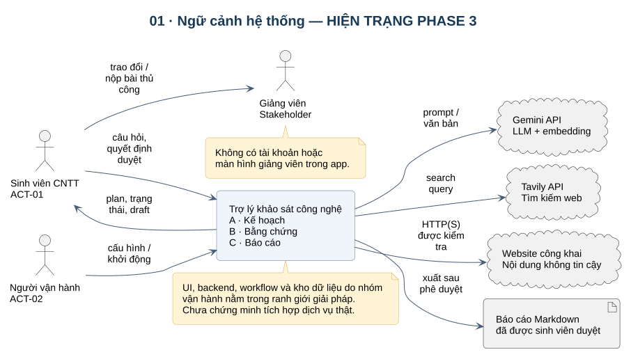
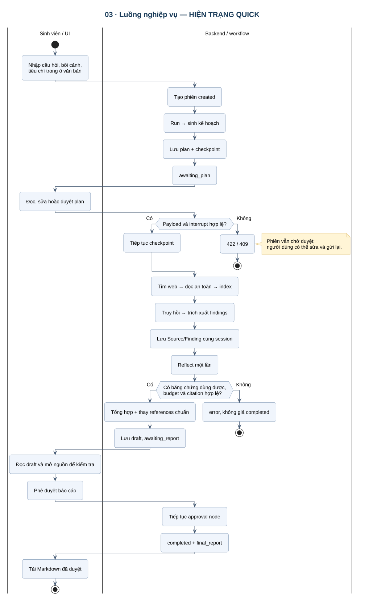
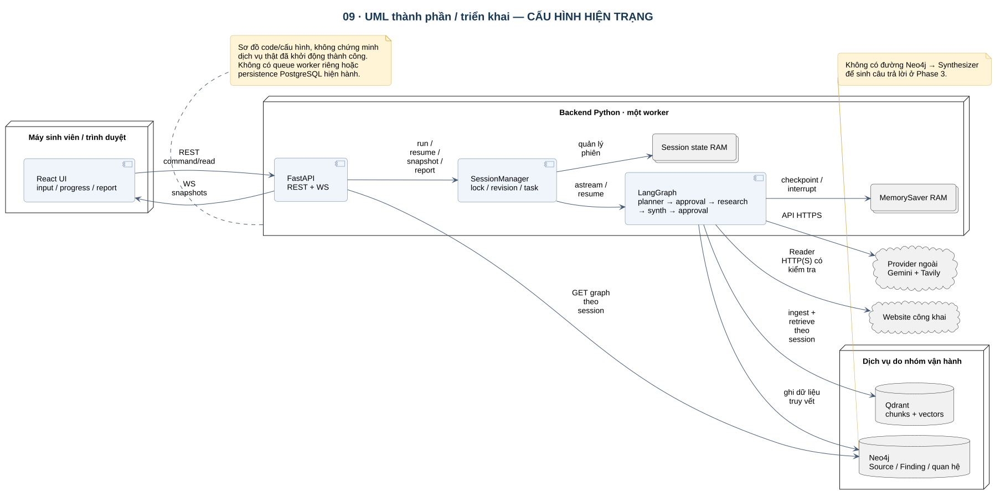
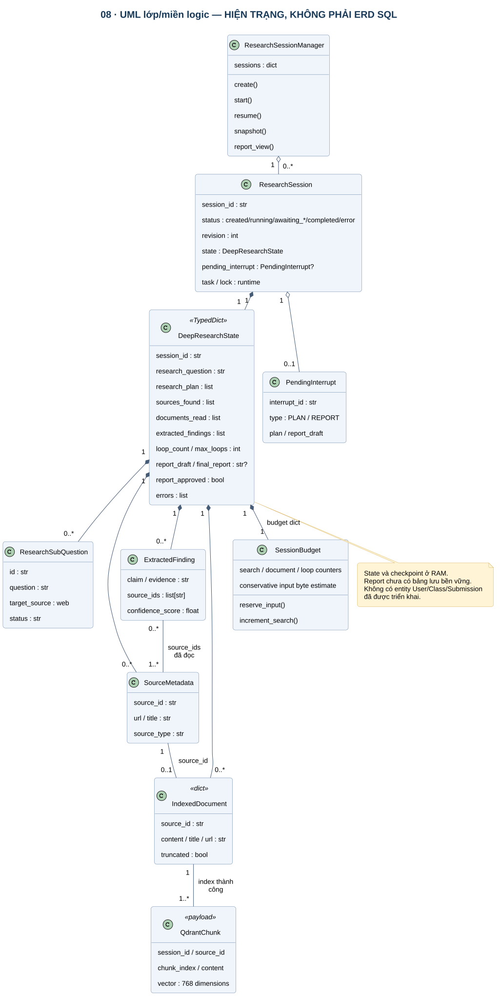

# 04 · Phân tích–thiết kế hệ thống

## Baseline và cách đọc hình

Các sơ đồ 01–09 mô tả **hiện trạng sau Phase 3**, được đối chiếu với code; 10–11 là quy trình/mở rộng **đề xuất**. Đây là thiết kế được dựng lại sau implementation, không phải bằng chứng đã thiết kế trước khi code. Các bước tiếp theo phải có yêu cầu và thiết kế được duyệt trước.

## Luồng nghiệp vụ và tương tác

| Sơ đồ | Đọc để hiểu gì? | Chi tiết phải đúng |
|---|---|---|
| [04 · Sequence lập/duyệt kế hoạch](diagrams/svg/04-sequence-plan.svg) | Từ câu hỏi tới checkpoint và phê duyệt | Create không tự chạy; run là REST riêng; resume dùng interrupt_id hiện tại |
| [05 · Sequence nghiên cứu](diagrams/svg/05-sequence-research.svg) | Dữ liệu đi qua provider/kho nào | Chỉ docs index thành công mới vào documents_read; mỗi lượt gọi có budget |
| [06 · Sequence duyệt/xuất báo cáo](diagrams/svg/06-sequence-report.svg) | Bản nháp thành bản cuối thế nào | Approve không sinh lại report; chỉ final đã duyệt mới export |
| [07 · State machine](diagrams/svg/07-session-state.svg) | Khi nào cho phép run/resume/export | Không có trạng thái thành công khi graph lỗi; restart làm mất session |

Quick đặt max_loops=1 tại API tạo phiên. Reflector vẫn chạy một lần, nhưng không tự mở thêm vòng thu thập; không dùng sơ đồ loop nhiều vòng để mô tả khả năng hiện có. WebSocket chỉ quan sát; lệnh điều khiển dùng REST.

## Kiến trúc thành phần

- React hiển thị câu hỏi, tiến độ, plan, draft/final và thao tác phê duyệt.
- FastAPI nhận command/read request. ResearchSessionManager giữ trạng thái, task, lock, revision và pending interrupt.
- LangGraph chạy các node, lưu checkpoint RAM, dừng tại plan_approval/report_approval.
- Qdrant lưu chunk/vector theo session và phục vụ truy hồi cho Extractor.
- Neo4j lưu Source/Finding và quan hệ cùng phiên. **Synthesizer hiện không truy vấn Neo4j để viết báo cáo.** Đây chưa phải bằng chứng có GraphRAG hay graph reasoning.
- Gemini nhận các lời gọi LLM/embedding; Tavily tìm web; Reader truy cập website nguồn.
- PostgreSQL chỉ có cấu hình và ý định cho phase lưu trữ; chưa lưu session/report hiện hành.

Ranh giới tin cậy: nội dung trang và output model không đáng tin mặc định. URL được kiểm tra trước fetch; vector, payload, reference và session ID được kiểm tra/lọc tại các bước tương ứng. Điều này không thay thế xác thực/phân quyền khi triển khai đa người dùng.

## Mô hình miền và dữ liệu

Đây là mô hình lớp/miền logic, **không phải ERD của PostgreSQL đã tồn tại**.

| Đối tượng | Nguồn hiện trạng | Nơi giữ dữ liệu |
|---|---|---|
| ResearchSession | [session_manager.py](../../backend/app/services/session_manager.py) | RAM; status, revision, state, interrupt, task/lock |
| DeepResearchState | [state.py](../../backend/app/graph/state.py) | State/checkpoint RAM; plan, sources, docs, findings, report, budget |
| ResearchSubQuestion, SourceMetadata, ExtractedFinding | [schemas.py](../../backend/app/models/schemas.py) | Model trong state; không phải table ORM |
| SessionBudget | [budget.py](../../backend/app/models/budget.py) | Dict trong checkpoint; không phải hóa đơn API |
| Document | Dict tạo trong [reader.py](../../backend/app/graph/nodes/reader.py) | Nội dung index có giới hạn, URL, source_id, truncated |
| Chunk/vector | [qdrant_service.py](../../backend/app/services/qdrant_service.py) | Qdrant; session_id/source_id/chunk_index/content/vector |
| Source/Finding/EXTRACTED_FROM | [neo4j_service.py](../../backend/app/services/neo4j_service.py) | Neo4j; khóa và truy vấn có session |
| Report | report_draft/final_report trong state | Chưa có kho báo cáo bền vững độc lập |

Sinh viên là actor, không phải bảng User đã có. Cũng chưa có bảng lớp học, giảng viên hay bài nộp.

## Hợp đồng điều khiển

| API | Hành vi | Quy tắc |
|---|---|---|
| POST /api/v1/research/start | Tạo phiên Quick | Trả created; không phát sinh graph run |
| POST /api/v1/research/{id}/run | Chạy phiên created | Một lần; lặp/không đúng trạng thái trả 409 |
| GET /api/v1/research/{id} | Snapshot | Không bắt đầu công việc mới |
| POST /api/v1/research/{id}/resume | Quyết định approve/modify | action + interrupt_id + plan khi sửa plan; stale trả 409 |
| GET /api/v1/research/{id}/report | Đọc draft hoặc final đã lưu | Chưa có report trả 409; không gọi LLM |
| GET /api/v1/research/{id}/export?format=md | Tải final đã duyệt | Chưa duyệt trả 409; PDF/DOCX 501 |
| WS /ws/research/{id} | Snapshot/tiến độ | Không nhận lệnh START/resume; nhiều observer có thể xem cùng phiên |

interrupt_id là token của ứng dụng cho quyết định đang chờ; thread_id của LangGraph gắn với session_id. revision chống cập nhật trạng thái lùi trên client. Progress là các mốc theo node, không đo khối lượng việc còn lại. Snapshot công khai không chứa raw document, lock hay đường dẫn file riêng.

## Điểm thiết kế còn cần quyết định

1. Evidence có trong state nhưng chưa có gói xuất kiểm chứng cho sinh viên/cô. Thiết kế gói này trước khi thay UI.
2. Neo4j đang là một phụ thuộc khởi động của app dù chưa giúp sinh báo cáo. Cần kiểm chứng utility hoặc tách/bỏ phụ thuộc ở thiết kế tiếp theo; chưa sửa implementation trong đợt lập hồ sơ này.
3. Qdrant phù hợp retrieval có filter; với tối đa tám trang ngắn, direct-context có thể đơn giản hơn. Phải đo.
4. Session RAM và checkpoint RAM có hai vai trò: trạng thái phục vụ API và vị trí tiếp tục workflow. Bản bền vững phải thống nhất phục hồi hai vai trò, không chỉ thêm một bảng report.
5. Chọn nguồn, feedback, nhiều vòng và đăng nhập không được vẽ như đã có. [Sơ đồ mục tiêu](diagrams/svg/11-use-cases-target.svg) chỉ là đề xuất.
