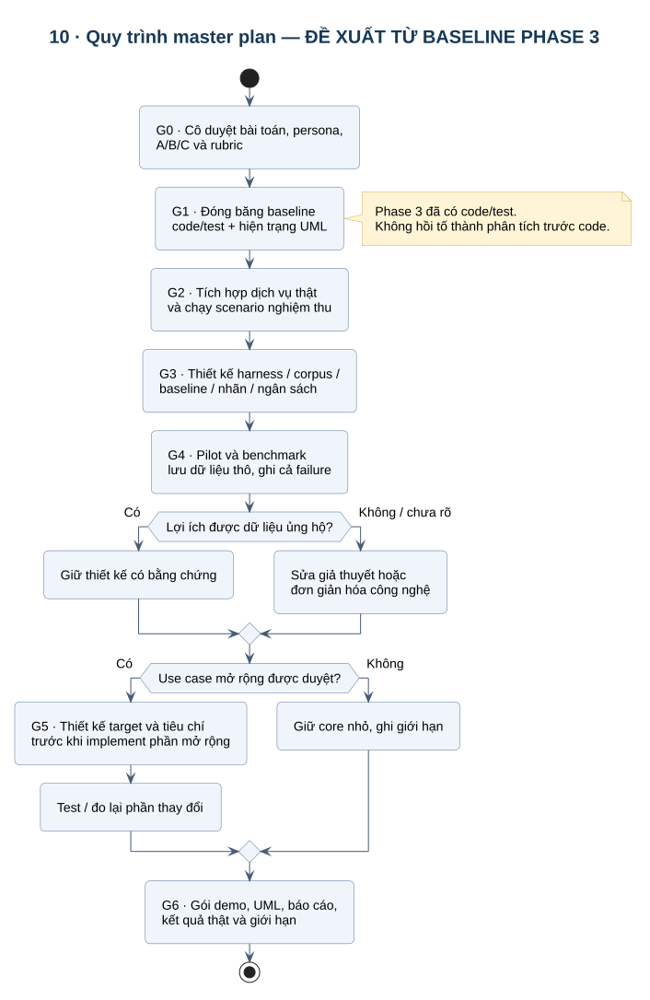

# 05 · Master plan và quyết định công nghệ

## Mục tiêu tổng

Chứng minh hệ thống hỗ trợ sinh viên CNTT tạo **bản khảo sát công nghệ có thể kiểm tra** trong điều kiện tài nguyên xác định. Hoàn thành đồ án không được đo bằng số thư viện, số node hay số màn hình.

## Gate và deliverable

| Gate | Việc cần làm trước khi qua gate | Deliverable / điều kiện ra |
|---|---|---|
| **G0 · Chốt bài toán** | Cô duyệt persona, A/B/C, đầu ra, tình huống demo và phần ngoài phạm vi | Tài liệu 01/03/07 có nhận xét và quyết định phạm vi; hiện chỉ người dùng đã chốt persona |
| **G1 · Đóng băng baseline** | Gắn hiện trạng code/test với use case và sơ đồ | Phase 3 có code/test; 60 test không chứng minh chất lượng research; lưu fingerprint/config cho lần đo |
| **G2 · Demo dịch vụ thật** | Cấu hình provider/database; thử một câu hỏi, một lỗi và hai phiên | Log chạy thật, draft/final/export và lỗi đúng; người dùng đã chọn làm tích hợp thật sau |
| **G3 · Chuẩn bị đo** | Instrument thời gian, call/token/cost; lưu corpus/context/plan/report, nhãn chuẩn | Harness đo và gói evidence **chưa có**; corpus/pilot/holdout/rubric được duyệt trước đo |
| **G4 · Kiểm chứng** | Chạy baseline công bằng, pilot sinh viên, đọc claim và nguồn | Dữ liệu thô + bảng kết quả + giới hạn; không chỉ một demo đẹp |
| **G5 · Mở rộng có điều kiện** | Chỉ thêm chức năng giải quyết use case còn thiếu | PDF/URL, feedback, graph hoặc persistence có thiết kế và tiêu chí riêng; không mặc định làm hết |
| **G6 · Nộp/bảo vệ** | Lặp lại demo từ hướng dẫn; đối chiếu yêu cầu → test → kết quả | Báo cáo phân tích, UML đã render, kết quả đo thật, gói demo và danh sách giới hạn |

Đây là master plan nghiệp vụ/kiểm chứng. [BUILD_PLAN.md](../BUILD_PLAN.md) là phân rã implementation theo phase. Sau ba phase, bước kế tiếp là **G0/G2/G3 theo phạm vi được duyệt**, không tự động code Phase 4.

Ước lượng để lập lịch, chưa phải cam kết: một vòng chuẩn bị/chốt phạm vi; một vòng tích hợp và instrument; một vòng pilot/đo; một vòng xử lý phần thiếu và viết báo cáo. Cần đối chiếu thời hạn nộp và khả năng tiếp cận người tham gia; hiện chưa có các ràng buộc này.

## Quy trình thay đổi từ đây

Đề xuất vấn đề → viết use case/điều kiện nghiệm thu → vẽ thay đổi actor/state/sequence/data → xem xét phương án nhỏ hơn → cô/nhóm duyệt phạm vi → implement → test → đo nếu có tuyên bố lợi ích → cập nhật hồ sơ. Không dùng tài liệu này để giả định cô đã đồng ý mọi chức năng tương lai.

## Decision record công nghệ

| ID | Quyết định hiện tại | Vì sao có thể cần? | Phương án nhỏ hơn / rủi ro | Cần chứng minh hoặc điều kiện thay đổi |
|---|---|---|---|---|
| ADR-01 | LangGraph điều phối | Cần state, checkpoint và hai lần chờ người dùng | Async functions + state machine tự viết; giảm dependency nhưng tự xử lý resume | Test resume không sinh lại plan/report và giữ budget đã có; không suy ra multi-agent hay reasoning tốt hơn |
| ADR-02 | REST command + WS observer | Một đường command, cập nhật tiến độ và reconnect | Polling GET đơn thuần đơn giản hơn | Chứng minh cập nhật không lùi/không chạy trùng; nếu tải nhỏ, WS là lựa chọn UX chứ không phải lợi thế nghiên cứu |
| ADR-03 | Qdrant, **tạm giữ để kiểm chứng** | Truy hồi chunk theo câu hỏi và filter theo session | Direct-context hoặc retrieval đơn giản; tám trang nhỏ có thể chưa cần vector DB | Ablation retrieval vs direct-context, cùng nguồn và budget; giữ khi có lợi ích đo được |
| ADR-04 | Neo4j, **thử nghiệm** | Có thể phục vụ truy vết claim–source và quan hệ | Dict/bảng quan hệ hoặc bỏ graph khỏi critical path | Hiện không dùng để viết report. Chỉ ưu tiên UI graph nếu giúp sinh viên truy bằng chứng nhanh/đúng hơn; không có lợi thì đơn giản hóa thiết kế |
| ADR-05 | RAM session/checkpoint | Nhỏ, dễ kiểm tra prototype một worker | SQLite/PostgreSQL cho lưu bền vững | RAM chỉ phù hợp demo không restart; nếu rubric cần mở lại phiên sau restart thì Phase 7 thành bắt buộc |
| ADR-06 | Gemini và Tavily cấu hình qua env | Provider đang được nối sẵn, cung cấp model/embedding/search | Dịch vụ tương đương hoặc model local | Chưa chứng minh rẻ/nhanh/đúng hơn; đổi vendor cần thiết kế adapter và đo lại, không chỉ sửa tên model |
| ADR-07 | React/Vite và FastAPI | Plan editor, tiến độ, báo cáo; backend Python async thuận tiện cho workflow | Server-rendered UI nhỏ hơn nếu bỏ tương tác phức tạp | Chi phí maintain hai app; build/test hiện có, usability chưa đo |
| ADR-08 | HTTPX/BeautifulSoup đọc trực tiếp | Kiểm soát URL, redirect, response và lỗi | Proxy đọc trang hoặc dịch vụ browser | Không đọc được mọi trang JS/PDF; không đánh đổi TLS/SSRF để tăng coverage |

[LangGraph interrupts](https://docs.langchain.com/oss/python/langgraph/interrupts) cung cấp cơ chế chờ và tiếp tục state; test của dự án mới là bằng chứng cách nối đúng. [Qdrant filtering](https://qdrant.tech/documentation/search/filtering/) hỗ trợ điều kiện payload; filter không tự tạo cơ chế phân quyền người dùng.

## Ưu tiên sau rà soát

1. G0: chốt rubric và một tình huống khảo sát công nghệ cụ thể với cô.
2. G2/G3: chạy thật và bổ sung evidence/measurement tối thiểu, trước khi thêm nhiều nguồn hay nhiều vòng.
3. G4: kiểm tra A/B/C có ích cho sinh viên không; xem Qdrant/reflection có đáng chi phí.
4. Chọn G5 theo kết quả: graph, paper/PDF, feedback hay persistence. Có thể giữ bộ core nhỏ nếu đủ yêu cầu.

## Tuyên bố không được đưa vào báo cáo khi chưa có phép đo

“Nhanh hơn X%”, “faithfulness Y%”, “tốt hơn ChatGPT/Gemini”, “GraphRAG giúp giảm hallucination”, “reflection tối ưu khi chạy 2,1 vòng”, “100% nguồn thật”. Mỗi tuyên bố phải trỏ tới một thực nghiệm, dữ liệu thô và baseline trong tài liệu 06; nếu chưa có thì ghi **CHƯA ĐO**.
